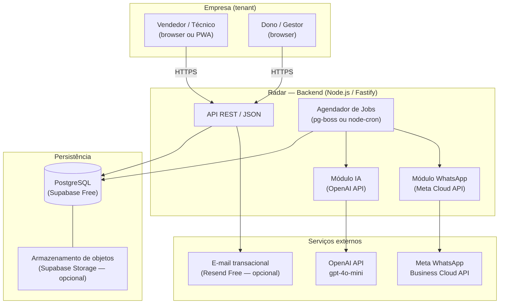
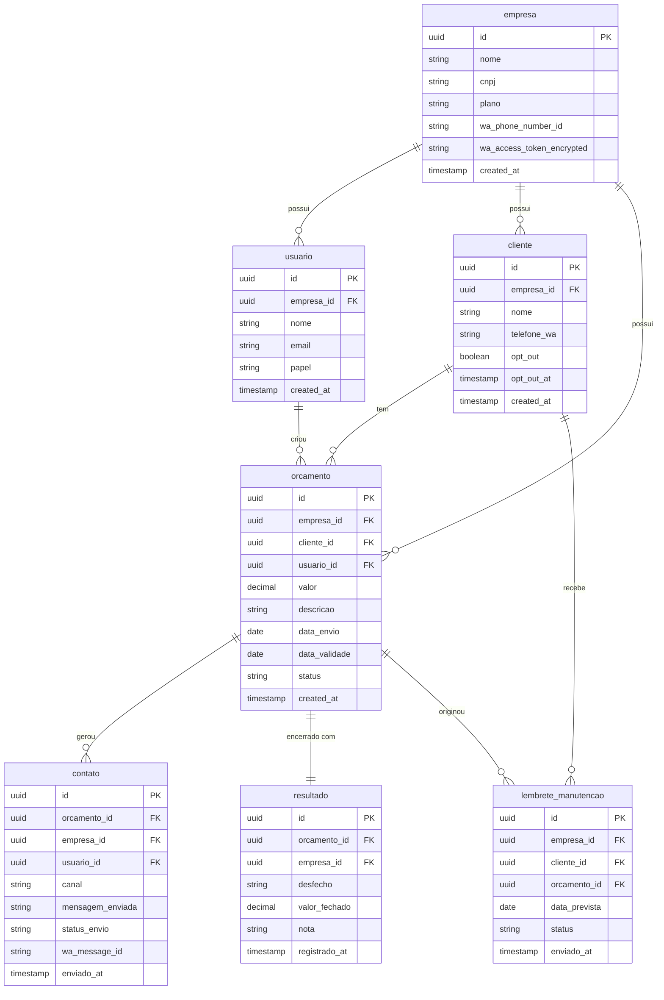

# arquitetura.md — Radar SaaS · Rascunho Condicional de Arquitetura (Fase 2)

> **RASCUNHO CONDICIONAL** — Este documento só tem validade operacional se o Portão de Decisão (seção 5 do radar.md) retornar decisão **Seguir**. Não inicia nenhuma implementação por si só.
>
> Data do rascunho: 2026-10-14
> Suposições marcadas com 🔷; itens que requerem confirmação de preços marcados com ⚠️.
>
> ## 🚧 Estado de implementação (atualizado 2026-10-14)
>
> O Portão de Decisão **continua aberto**, mas o desenvolvedor autorizou formalmente o início da construção (opção A — exceção registrada em `NoRadar.md` seção 8, risco de reversão aceito). Por isso parte deste documento **já saiu do papel**:
>
> | Item deste documento | Situação real em 2026-10-14 |
> |---|---|
> | `apps/web` (interface) | **Construído** — Next.js **15.5.28** (o planejado era 14) + React **19.3.1** + Tailwind **4.3.3** |
> | `apps/api` (backend) | **Construído** — Fastify **5.12.7** no Node **v24.18.0** (o planejado era Node 22) |
> | `packages/shared` | **Construído** — tipos + schemas **Zod 4.6.7** |
> | Banco (PostgreSQL/Supabase) | **NÃO implementado** — decisão D2: camada mockada atrás da interface `OrcamentoRepository` |
> | ORM Drizzle | **NÃO implementado** — sem banco nesta etapa |
> | pg-boss / jobs agendados | **NÃO implementado** |
> | IA (OpenAI) e WhatsApp (Meta) | **NÃO implementados** — nenhuma credencial configurada; `.env.example` com campos `[BLOQUEADO]` |
> | Auth / multiempresa (RLS) | **NÃO implementado** |
>
> Os valores de versão acima são os **efetivamente instalados** (lockfile `pnpm-lock.yaml` preservado), não os do planejamento. As divergências de versão em relação ao planejamento estão registradas aqui de propósito: o planejamento assumia Node 22 e Next 14; o ambiente real tem Node 24 e o `next@15` é o estável instalado.

---

## 1. Visão Geral e Componentes

O Radar é um SaaS de recuperação de orçamentos voltado a pequenas empresas (ar-condicionado, assistência técnica, manutenção). O vendedor usa o sistema para acompanhar orçamentos sem resposta, aprovar sugestões de mensagem geradas por IA e enviá-las via WhatsApp oficial. O dono vê o impacto financeiro no painel.

### Diagrama de componentes



**Componentes principais:**

| Componente | Responsabilidade |
|---|---|
| API REST | Autenticação, CRUD de orçamentos, aprovação de mensagens, painel |
| Agendador de Jobs | Verificar orçamentos vencidos, gerar tarefas, disparar lembretes |
| Módulo IA | Gerar sugestão de mensagem; sempre exige aprovação humana |
| Módulo WhatsApp | Enviar mensagem aprovada via Meta Cloud API com modelo aprovado |
| Frontend (SPA/PWA) | Fila diária de follow-up, aprovação de mensagem, painel financeiro |
| PostgreSQL | Fonte única de verdade; isolamento por tenant (`empresa_id`) |

---

## 2. Stack Recomendada

> Critério de seleção: funcionar em PC com poucos recursos de desenvolvimento, usar planos gratuitos ou baratos, evitar complexidade desnecessária no MVP.

### 2.1 Backend

| | Escolha | Justificativa | Alternativa |
|---|---|---|---|
| **Runtime** | Node.js 22 LTS | Ecossistema amplo, roda leve localmente, o dev provavelmente já conhece JS | Python (FastAPI) — mais rápido para prototipagem se o dev dominar Python |
| ↳ **em produção** | **Node v24.18.0** | Ambiente real do dev; `engines` do `package.json` declara `>=24` | — |
| **Framework** | Fastify | Mais rápido e mais leve que Express; JSON schema nativo reduz bugs | Express.js — mais popular, mais material de apoio |
| **ORM** | Drizzle ORM | SQL real visível, sem magia, bundle muito pequeno | Prisma — mais ergonômico, mas gera artefatos maiores |
| **Agendador** | pg-boss | Jobs persistidos no próprio PostgreSQL; sem Redis extra | node-cron — mais simples, mas perde jobs se o processo cair |

### 2.2 Banco de Dados

| | Escolha | Justificativa | Alternativa |
|---|---|---|---|
| **Banco** | PostgreSQL via Supabase | Plano gratuito inclui 500 MB + Auth + Storage; sem servidor extra para gerenciar | PlanetScale (MySQL) — menos recursos no free tier; ou Neon (Postgres) — boa alternativa se Supabase mudar de preços |
| **Backup** | Supabase Scheduled Backups (plano pago) ou pg_dump manual | 🔷 Suposição: plano Pro ($25/mês) ativa backups diários automáticos | Script de pg_dump exportado para Google Drive gratuitamente |

### 2.3 Frontend

| | Escolha | Justificativa | Alternativa |
|---|---|---|---|
| **Framework** | Next.js 14 (App Router) | SSR leve, fácil deploy na Vercel gratuita, TypeScript out-of-the-box | Vite + React — mais leve para SPAs puras, sem SSR |
| ↳ **em produção** | **Next.js 15.5.28** (App Router) | Estável instalado no ambiente real | — |
| **Estilo** | Tailwind CSS | Produtividade alta, sem CSS custom volumoso | shadcn/ui sobre Tailwind — componentes prontos que reduzem ainda mais o tempo |
| **Estado** | Zustand | Minimalista, sem boilerplate do Redux | React Query (TanStack) — ideal se o estado for principalmente cache de servidor |

### 2.4 Filas / Agendamento

| | Escolha | Justificativa | Alternativa |
|---|---|---|---|
| **Jobs** | pg-boss (PostgreSQL-backed) | Sem infraestrutura adicional; os jobs ficam na mesma base já paga | BullMQ (Redis) — mais robusto, mas exige Redis (~$7/mês mínimo no Railway) |
| **Cron** | pg-boss schedule | Mesmo sistema; cron integrado | GitHub Actions scheduled — gratuito, mas frágil para jobs críticos |

### 2.5 Hospedagem

| | Escolha | Justificativa | Alternativa |
|---|---|---|---|
| **Frontend** | Vercel (free) | Deploy contínuo do GitHub, CDN global, domínio custom | Netlify — similar; Cloudflare Pages — mais rápido, mas menos integrado com Next.js |
| **Backend** | Railway (Starter $5/mês) | Containers Docker simples, deploys automáticos, sem configurar VPS | Render (free tier) — free tier hiberna após inatividade, inadequado para jobs agendados |
| **Banco** | Supabase (free → Pro) | Ver acima | Neon (free 0.5 GB) |
| **Domínio** | Registro.br (~R$ 40/ano) | .com.br, controlado localmente | .com via Namecheap (~$12/ano) |

---

## 3. Modelo de Dados

> Todas as tabelas incluem `empresa_id` para isolamento multiempresa (RLS no Supabase).

### Entidades Principais



### Enum `status` do orçamento

| Valor | Significado |
|---|---|
| `enviado` | Enviado ao cliente, aguardando resposta |
| `em_followup` | Tarefa de follow-up gerada |
| `respondido` | Cliente respondeu (positivo ou negativo) |
| `fechado` | Venda confirmada |
| `recusado` | Cliente recusou |
| `expirado` | Passou da validade sem retorno |

### Enum `desfecho` do resultado

`fechou` · `recusou` · `pediu_alteracao` · `sem_retorno` · `reativado_manutencao`

---

## 4. Fluxos Principais

### 4.1 Registrar Orçamento

```
Vendedor abre o Radar
  → Preenche: cliente, valor, descrição, data de validade
  → Backend salva orcamento (status = "enviado")
  → Job agenda verificação para D+prazo_sem_resposta (🔷 suposição: padrão 3 dias úteis configurável)
```

### 4.2 Detectar Orçamento Sem Resposta

```
Job roda diariamente (ex.: 08h00 horário da empresa)
  → Busca orcamentos WHERE status = "enviado"
    AND data_validade >= CURRENT_DATE (não expirado)
    AND data_envio <= NOW() - prazo_sem_resposta
    AND NOT EXISTS (SELECT 1 FROM contato WHERE orcamento_id = ...)
  → Para cada orçamento encontrado:
      → Atualiza status = "em_followup"
      → Insere tarefa na fila diária do vendedor
```

### 4.3 Gerar Tarefa de Follow-Up

```
Fila diária ordenada por:
  1. Urgência (validade mais próxima primeiro)
  2. Valor (maior valor primeiro)
  3. 🔷 Probabilidade de retorno (futura — não entra no MVP)
Vendedor vê a fila ao abrir o sistema
```

### 4.4 Sugerir Mensagem por IA com Aprovação do Vendedor

```
Vendedor clica em "Sugerir mensagem" para um item da fila
  → Backend monta prompt com:
      - Nome do cliente
      - Descrição do serviço
      - Valor do orçamento
      - Dias desde o envio
      - Instruções de tom (profissional, cordial, sem pressão)
  → Chama OpenAI API (gpt-4o-mini)
  → Retorna sugestão para o vendedor
  → Vendedor lê, edita se quiser, clica em "Aprovar e Enviar"
  ⚠️ NUNCA envia sem aprovação explícita do vendedor
```

### 4.5 Enviar pelo WhatsApp Oficial

```
Vendedor aprova a mensagem
  → Backend verifica opt-out do cliente (bloqueia se true)
  → Backend usa modelo de mensagem pré-aprovado pela Meta
      (a sugestão da IA preenche variáveis do modelo — ex.: {{nome}}, {{descricao}}, {{valor}})
  → Chama Meta Cloud API: POST /messages
  → Registra na tabela contato: mensagem, status_envio, wa_message_id
  → Aguarda webhook de entrega (delivered / read / failed)
```

> ⚠️ **Restrição crítica:** Toda mensagem iniciada pelo sistema (fora da janela de 24h) deve usar template aprovado pela Meta. O conteúdo da IA preenche as variáveis do template, mas o template em si é fixo e aprovado previamente.

### 4.6 Registrar Resultado

```
Vendedor recebe resposta do cliente (no WhatsApp pessoal ou pelo Radar)
  → Abre o orçamento no Radar
  → Seleciona desfecho: fechou / recusou / pediu_alteracao / sem_retorno
  → Se "fechou": informa valor confirmado (pode diferir do orçado)
  → Backend salva resultado e atualiza status do orçamento
  → Se serviço implica manutenção futura: propõe criar lembrete_manutencao
```

### 4.7 Calcular Receita Atribuída

```
Regra de atribuição (🔷 suposição — confirmar com usuário):
  receita_atribuida = SUM(resultado.valor_fechado)
    WHERE resultado.desfecho = 'fechou'
    AND EXISTS (
      SELECT 1 FROM contato
      WHERE contato.orcamento_id = resultado.orcamento_id
      AND contato.status_envio IN ('delivered', 'read')
    )

Painel exibe (por período selecionável):
  - Orçamentos registrados
  - Orçamentos acompanhados (com pelo menos 1 contato registrado)
  - Orçamentos fechados após follow-up
  - Receita atribuída ao Radar
  - Taxa de conversão do follow-up
```

---

## 5. Integração com WhatsApp

### 5.1 Canal Oficial

O Radar usa exclusivamente a **Meta WhatsApp Business Cloud API** (sem BSP intermediário no MVP — 🔷 suposição, confirmar custo de BSP vs. Cloud API direto).

| Aspecto | Regra |
|---|---|
| **Autorização (opt-in)** | Cliente deve ter optado em receber mensagens (confirmação via mensagem inicial ou formulário físico) |
| **Templates** | Todas as mensagens iniciadas pelo sistema precisam de template aprovado pela Meta. Templates em português precisam ser submetidos e podem levar até 24h para aprovação |
| **Janela de 24h** | Dentro da janela de conversação aberta pelo cliente, mensagens livres são permitidas. Fora dela, somente templates |
| **Opt-out** | Campo `cliente.opt_out`; ao receber "SAIR" ou pedido equivalente, sistema bloqueia envios imediatamente e registra data |
| **Webhook** | Meta envia status de entrega (sent / delivered / read / failed) via webhook HTTPS — sistema atualiza `contato.status_envio` |

### 5.2 Templates Necessários no MVP (estimativa)

| Template | Uso |
|---|---|
| `followup_orcamento` | Follow-up de orçamento sem resposta (variáveis: nome, descrição, valor) |
| `lembrete_manutencao` | Lembrete de manutenção preventiva (variáveis: nome, tipo_servico, data_prevista) |
| `confirmacao_optin` | Confirmação de opt-in inicial (se feito via WhatsApp) |

### 5.3 Impacto das Tarifas no Custo

⚠️ **Os preços abaixo são estimativas; confirmar na tabela oficial da Meta (business.whatsapp.com/pricing) antes de usar.**

> 🔴 **AUDITORIA 2026-10-14 — NÃO CONFIRMADO.** Tentativa de abrir as páginas oficiais da Meta (`business.whatsapp.com/pricing`, `developers.facebook.com/docs/whatsapp/...`) nesta sessão **falhou** (erros 000/400/404). **Nenhuma tarifa desta seção foi verificada** — os valores vêm de memória/estimativa de 2024 e não podem sustentar o critério 7 do Portão de Decisão. Ver `concorrencia.md`, seção 0.7.

| Tipo de conversa | Tarifa estimada (Brasil, 2024) | Quem paga |
|---|---|---|
| Conversa iniciada pela empresa (marketing/utility) | ~R$ 0,20–0,60 por conversa de 24h | Radar repassa ao cliente |
| Conversa iniciada pelo usuário final | ~R$ 0,05–0,10 por conversa de 24h | Radar repassa ao cliente |
| 1.000 conversas gratuitas/mês por número | R$ 0,00 | — |

**Impacto no modelo de negócio:** se uma empresa faz 50 follow-ups/mês e cada um abre uma conversa nova (~R$ 0,40), o custo de WhatsApp é ~R$ 20/mês por empresa. Isso deve ser embutido no preço da assinatura ou cobrado separadamente como créditos.

---

## 6. Uso de IA

### 6.1 Onde a IA Entra

| Ponto | Função | Obrigatoriedade |
|---|---|---|
| Sugestão de mensagem de follow-up | Gera texto personalizado com base no contexto do orçamento | Sempre exige aprovação do vendedor |
| Sugestão de mensagem de reativação de manutenção | Idem, adaptado para lembrete preventivo | Sempre exige aprovação do vendedor |
| 🔷 Priorização da fila (futuro) | Estimar probabilidade de conversão | Fora do MVP |

### 6.2 Custo Estimado por Mensagem

⚠️ **Preços da OpenAI mudam frequentemente. Confirmar em platform.openai.com/pricing.**

> 🔴 **AUDITORIA 2026-10-14 — NÃO CONFIRMADO.** A página oficial foi acessada nesta sessão, mas a tabela de preços é dinâmica e **não expôs o valor por token de `gpt-4o-mini`** no conteúdo obtido (`openai.com/api/pricing` retornou 403). **Os valores abaixo continuam sendo estimativa de memória** e não foram corrigidos por suposição. Ver `concorrencia.md`, seção 0.8.

| Modelo | Custo input (estimativa) | Custo output (estimativa) | Custo por sugestão (~500 tokens total) |
|---|---|---|---|
| gpt-4o-mini | ~$0,15/M tokens | ~$0,60/M tokens | ~$0,0004 (< R$ 0,01) |
| gpt-4o | ~$2,50/M tokens | ~$10,00/M tokens | ~$0,007 (~R$ 0,04) |

**Recomendação:** usar `gpt-4o-mini` para mensagens de follow-up. O custo é desprezível mesmo com centenas de sugestões por mês.

### 6.3 Como Evitar Mensagens Inadequadas

| Proteção | Implementação |
|---|---|
| **Aprovação obrigatória** | Sistema só envia após clique explícito do vendedor ("Aprovar e Enviar") |
| **Prompt com instruções de tom** | System prompt define: cordial, profissional, sem pressão, sem promessas não autorizadas |
| **Limite de tamanho** | Resposta limitada a 300 caracteres para caber no template aprovado |
| **Template fixo** | A IA preenche variáveis, não escreve o template inteiro; o texto-base é fixo e aprovado |
| **Log completo** | Toda sugestão gerada é salva (mesmo as não enviadas) para auditoria |

---

## 7. Multiempresa (SaaS), Segurança, LGPD e Backups

### 7.1 Isolamento Multiempresa

- Todas as tabelas possuem `empresa_id` (UUID).
- Row Level Security (RLS) do Supabase garante que queries retornem apenas dados do tenant autenticado.
- Tokens de WhatsApp são armazenados criptografados (`wa_access_token_encrypted`); a chave de criptografia fica em variável de ambiente, não no banco.
- 🔷 Suposição: um usuário pertence a uma única empresa no MVP. Multi-empresa por usuário fica fora do MVP.

### 7.2 Autenticação e Autorização

| Camada | Mecanismo |
|---|---|
| Autenticação | Supabase Auth (email/senha + magic link) |
| Sessão | JWT com refresh token; expiração curta (1h) |
| Papéis no MVP | `admin` (dono) e `vendedor`; admin vê painel financeiro, vendedor vê fila |
| Rate limiting | Fastify rate-limit por IP e por usuário (evitar abuso da API de IA) |

### 7.3 LGPD

| Requisito | Implementação planejada |
|---|---|
| Base legal para envio de WhatsApp | Legítimo interesse ou consentimento — registrar opt-in com data e canal |
| Direito ao esquecimento | Endpoint de exclusão de `cliente` que apaga dados pessoais e registra log de exclusão |
| Opt-out de mensagens | Campo `cliente.opt_out` + data; respeitado em todos os módulos de envio |
| Minimização de dados | Coletar apenas: nome, telefone, histórico de orçamentos — sem CPF no MVP |
| 🔷 Termos e política | A ser redigido (checklist Fase 2) |

### 7.4 Segurança Geral

- HTTPS em tudo (Let's Encrypt automático via Railway/Vercel).
- Secrets apenas em variáveis de ambiente (nunca em código ou repositório).
- Dependências auditadas com `npm audit` antes de cada deploy.
- 🔷 Pentest: fora do escopo do MVP; avaliação manual de endpoints críticos.

### 7.5 Backups

| Tipo | Frequência | Destino | Custo |
|---|---|---|---|
| pg_dump automático | Diário | 🔷 Google Drive via script (a confirmar) | Gratuito |
| Supabase backups | Diário (plano Pro) | Supabase | Incluído no Pro ($25/mês) ⚠️ confirmar |
| Retenção | 30 dias | — | — |

---

## 8. Estimativa de Custos Mensais

> ⚠️ **ESTIMATIVAS — não usar para decisão financeira sem confirmar preços atuais.**
> Câmbio assumido: 1 USD = R$ 5,80 (🔷 verificar antes de usar).
>
> 🔴 **AUDITORIA 2026-10-14 — CÂMBIO NÃO CONFIRMADO / DESATUALIZADO.** Consulta à **PTAX oficial do Banco Central** (`olinda.bcb.gov.br/olinda/servico/PTAX/...CotacaoDolarPeriodo`) em 2026-10-14: **venda R$ 5,0441**, compra R$ 5,0435 (cotação das 13h05). O valor de **R$ 5,80 assumido aqui não corresponde à PTAX do dia**.
> **Não recalculei os totais desta seção**: são três incógnitas não confirmadas ao mesmo tempo (câmbio, custo de IA e tarifa Meta). Recalcular só quando a tarifa Meta e o custo de IA tiverem fonte oficial aberta. Ver `concorrencia.md`, seções 0.7 e 0.8.

### Premissas

- Cada cliente = 1 empresa com ~50 follow-ups/mês via WhatsApp.
- ~30% dos follow-ups geram sugestão de IA (vendedor usa a IA).
- Cada sugestão de IA: ~500 tokens (gpt-4o-mini).
- Cada follow-up abre 1 conversa WhatsApp Business (~R$ 0,40 por conversa).

### Tabela de Custos

| Item | 3 clientes | 20 clientes | 100 clientes | Notas |
|---|---|---|---|---|
| **Railway (backend)** | $5/mês | $5–15/mês | $20–50/mês | Depende de CPU/RAM usados ⚠️ |
| **Supabase (banco)** | Free ($0) | Pro ($25) | Pro ($25+) | Free: 500 MB; Pro: 8 GB ⚠️ |
| **Vercel (frontend)** | Free ($0) | Free ($0) | Free / Pro ($20) | Limite de requisições no free ⚠️ |
| **OpenAI (IA)** | ~$0,01/mês | ~$0,05/mês | ~$0,25/mês | gpt-4o-mini; custo desprezível |
| **WhatsApp (Meta)** | ~R$ 60/mês | ~R$ 400/mês | ~R$ 2.000/mês | ~R$ 0,40/conversa × 50 × clientes ⚠️ |
| **Domínio** | R$ 3,50/mês | R$ 3,50/mês | R$ 3,50/mês | ~R$ 40/ano |
| **E-mail transacional** | Free (Resend) | Free / ~$20 | ~$20/mês | ⚠️ confirmar limites do free |
| **Total infra (USD→BRL)** | ~R$ 100/mês | ~R$ 530/mês | ~R$ 2.450/mês | Excluindo lucro e suporte |
| **Custo por cliente** | ~R$ 33 | ~R$ 26 | ~R$ 24 | Escala razoavelmente bem |

> **Nota sobre WhatsApp:** o custo de R$ 0,40/conversa é uma estimativa baseada nas tarifas de 2024. As tarifas da Meta mudam; confirmar em business.whatsapp.com/pricing. Se o custo de WhatsApp for repassado ao cliente como crédito separado, o custo de infra cai para ~R$ 40–120/mês independentemente do volume.

---

## 9. Fases de Construção do MVP

> Esforço em dias-desenvolvedor (1 dev, meio período, PC básico). 🔷 Estimativas; ajustar após Portão de Decisão.

| # | Entregável | Depende de | Esforço (dias) |
|---|---|---|---|
| **1** | Setup: repositório, Railway, Supabase, Vercel, CI básico | — | 2 |
| **2** | Auth: cadastro de empresa, login, papéis (admin/vendedor) | 1 | 3 |
| **3** | CRUD de clientes e orçamentos; model de dados completo | 2 | 4 |
| **4** | Job diário: detectar orçamentos sem resposta; fila de follow-up | 3 | 3 |
| **5** | Frontend: fila diária de tarefas; aprovação de mensagem | 4 | 5 |
| **6** | Integração IA: sugestão de mensagem via gpt-4o-mini | 5 | 3 |
| **7** | Integração WhatsApp: envio via Meta Cloud API + webhook de status | 6 | 5 |
| **8** | Registro de resultado; atualização de status do orçamento | 7 | 2 |
| **9** | Lembrete de manutenção preventiva | 8 | 3 |
| **10** | Painel financeiro: receita atribuída, taxa de conversão | 8 | 4 |
| **11** | Opt-out, LGPD básico (exclusão, log de opt-in) | 7 | 2 |
| **12** | Testes funcionais e de segurança mínimos | 10–11 | 3 |
| **13** | Deploy de produção, domínio, SSL, monitoramento básico | 12 | 2 |

**Total estimado:** ~41 dias de desenvolvimento (meio período ≈ 3 meses corridos).

### Ordem sugerida de construção

```
Semana 1–2:  [1] Setup + [2] Auth
Semana 3–4:  [3] Dados + [4] Job diário
Semana 5–7:  [5] Frontend fila + [6] IA
Semana 8–10: [7] WhatsApp + [8] Resultado
Semana 11–12:[9] Manutenção + [10] Painel
Semana 13:   [11] LGPD + [12] Testes + [13] Deploy
```

---

## 10. Riscos Técnicos e Fora do MVP

### 10.1 Riscos Técnicos

| Risco | Probabilidade | Impacto | Mitigação |
|---|---|---|---|
| Meta rejeitar templates ou revogar acesso | Média | Alto | Ter 2–3 templates aprovados antes do lançamento; monitorar status via API |
| Mudança de preço da Meta (tarifas WhatsApp) | Alta | Médio | Estrutura de repasse de custo separado ao cliente; revisar preços trimestralmente |
| Supabase free tier insuficiente para crescimento | Baixa (curto prazo) | Médio | Migrar para Pro ($25/mês) quando necessário; já planejado na estimativa |
| OpenAI aumentar preços ou mudar modelos | Média | Baixo | gpt-4o-mini é muito barato; mesmo 10x mais caro ainda seria irrelevante no custo |
| Job agendado falhar silenciosamente | Média | Alto | pg-boss registra falhas; alertas via log no Railway; testes de integração para jobs |
| Multiempresa com vazamento de dados entre tenants | Baixa (com RLS) | Crítico | Testes automáticos de isolamento de tenant; revisão de queries sem `empresa_id` |
| PC do dev com poucos recursos travar o ambiente | Alta | Baixo | Docker Compose só para banco local; backend/frontend rodam sem container no dev |

### 10.2 O Que Fica de Fora do MVP (conforme seção 3 do radar.md)

| Item | Motivo da exclusão |
|---|---|
| Chatbot autônomo (responde sozinho) | Risco regulatório (WhatsApp) e de reputação; aumenta complexidade |
| Discador automático | Fora do canal principal (WhatsApp); custo adicional |
| Emissão fiscal (NF-e/NFS-e) | Escopo muito diferente; integração com sistemas governamentais |
| Controle de estoque | Fora do posicionamento ("recuperação de orçamentos") |
| Gestão completa de OS | Concorrência direta com Vynix, Seva, OSFlow — não é o diferencial |
| Integração com CRMs externos | Complexidade de integração; verificar demanda real no piloto |
| Priorização da fila por IA | Dados insuficientes no MVP; implementar após ter histórico |
| Multi-empresa por usuário | Complexidade de permissões; avaliar após piloto |
| App mobile nativo | PWA cobre MVP; avaliar demanda no piloto |

---

## Suposições Listadas

> 🔷 Itens marcados com 🔷 ao longo do documento. Resumo consolidado:

1. Prazo padrão para detectar orçamento sem resposta: 3 dias úteis (configurável por empresa).
2. BSP intermediário vs. Meta Cloud API direta: assumido Cloud API direta; verificar se há restrição no Brasil.
3. Câmbio USD/BRL: R$ 5,80 — 🔴 **desatualizado em relação à PTAX do Banco Central de 2026-10-14 (venda R$ 5,0441)**; não foi substituído no texto porque o custo de IA e a tarifa Meta também seguem sem fonte oficial (ver auditoria acima).
4. Regra de atribuição de receita: fechamento após ao menos 1 contato registrado pelo Radar.
5. Um usuário pertence a uma única empresa no MVP.
6. Backup via pg_dump para Google Drive: script a ser desenvolvido.
7. Probabilidade de retorno na fila: fora do MVP (fila ordenada por prazo + valor).
8. Termos de uso e política de privacidade: a ser redigido na Fase 2 (checklist).

---

*Fim do rascunho condicional — aguardando Portão de Decisão para validar.*
